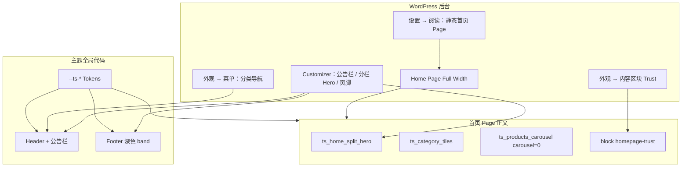

# Spoutini 户外商城改造指南

基于 ChatGPT 设计 Prompt 与首页 mockup，把 CosFusion（TailwindScore）改造成 Spoutini「Modern Outdoor Supply」视觉与首页的**可执行改造指南**。

**本文件性质**：架构纠偏 + mockup 映射 + 分阶段清单。后续编码按阶段 A–F 执行；写本指南时**不改** PHP / SCSS / TS / 模板。

**取代关系**：ChatGPT 附件 Prompt（`SPoutini-Cursor-Prompt.md`）中的设计意图、Tokens、Header/Footer 要求可复用；其中 **新增 `front-page.php`、改写 `home.php`、用 PHP 首页模板拼区块** 的方案**作废**，一律以本文为准。

**本地验证站**：`http://localhost/spoutini.com`（本机 WP-CLI 可用）。

**相关文档**：[首页](../features/homepage.md)、[首页 Hero](../features/home-hero.md)、[站点壳层](../features/site-shell.md)、[产品轮播](../features/product-carousel.md)、[内容区块](../modules/content-blocks.md)、[设计令牌](../architecture/design-tokens.md)、[命名约定](../conventions.md)、[wc-mailnest](../integrations/README.md)、[从 wc-enhanced-tools 迁移](../development/migration-from-wc-enhanced-tools.md)。

---

## 1. 品牌与视觉

### 1.1 定位

- 品牌：Spoutini — **Modern Outdoor Supply**
- 品类：露营、水上、徒步、钓鱼、旅行、户外游戏等多品类精选，**不要**写成只做露营的店
- 气质：现代、清爽、实用、有探索感；避免廉价促销模板与过度「露营插画」堆砌
- 前台默认可视文案：**英文**；文档与代码注释：**简体中文**（见 [conventions.md](../conventions.md)）

### 1.2 Token 映射（写入语义变量，不另起平行色板）

目标色（来自 Prompt + mockup）：

| 品牌名 | Hex | 建议映射到现有语义 |
|--------|-----|-------------------|
| Forest | `#244B3A` | `$ts-primary` / `$ts-primary-hover`（略加深作 hover）/ CTA、重要导航 |
| Moss | `#647B55` | 辅助强调：可映射 `$ts-on-secondary` 或次级强调；图标、次级状态 |
| Canvas | `#F7F5EF` | `$ts-surface-alt`（页面主背景 / body） |
| Sand | `#E9E3D6` | `$ts-surface-muted` 或分区柔和底（分类卡辅助底） |
| Charcoal | `#202722` | `$ts-text-primary`；深色 Footer 背景可复用或新增语义表面（见下） |
| Trail Orange | `#D97736` | **少用**：焦点/活动小面积；可作 `$ts-warning` 微调或局部组件变量，**禁止**大面积铺开 |
| 白 / 中性灰 | — | 卡片、表单、边框、禁用；`$ts-surface`、`$ts-border-color` 等 |

当前仓库仍为 COSFUSION 粉紫时尚色（见 [design-tokens.md](../architecture/design-tokens.md) 与 `_variables.scss` 中 `$ts-primary: #f22986` 等）。改造时：

1. **只改** [`src/scss/abstracts/_variables.scss`](../../src/scss/abstracts/_variables.scss)，并同步 [`_root.scss`](../../src/scss/abstracts/_root.scss)
2. **保留变量名与语义**（`primary` = CTA，`surface-alt` = 页面底…），替换字面量；不新建 `$ts-forest` / `$ts-pink` 平行体系
3. 重算 `$ts-gradient-brand` / `promo` / `soft`：公告栏 dark 方案目前吃 `--ts-gradient-brand`（粉→紫）；户外站应改为 Forest→Moss 一类低饱和渐变，或 dark 方案改为实色 Forest（实施时二选一并写进 design-tokens）
4. **深色 Footer**：现 Footer main band 默认 `--ts-surface`（亮色）。可选：
   - 为 Footer 增加语义 token（如 surface-inverse / on-inverse），或
   - 在 `_footer.scss` 用 Charcoal / Forest 实色 + 浅字对比度校验  
   换色优先走 token，避免组件内散落 hex
5. 同步更新 [design-tokens.md](../architecture/design-tokens.md) 中「COSFUSION 品牌双色与 Surface」小节为 Spoutini 户外语义说明
6. **全站检查**（不是只改首页）：按钮、链接、表单、导航、Drawer、商品卡、价格/促销、焦点、Header/Footer、公告栏

### 1.3 对比度与状态

- 文本在 Canvas / Sand / 深色 Footer 上需可读
- 保留 hover / active / disabled / focus-visible / loading / 错误态
- 字重规则不变：默认 400 / 600；禁止 500（见 conventions / design-tokens）

---

## 2. 架构硬约束

| 规则 | 说明 |
|------|------|
| **禁止** `front-page.php` | 首页 = **设置 → 阅读** 指定的静态 Page + **Full Width** + 正文短代码 / `[block]`（[homepage.md](../features/homepage.md)） |
| **禁止**改 `home.php` | `home.php` 仅博客「最新文章」归档 |
| 首页区块位置 | 在 Page `the_content()` 组合；壳层（Header/Footer）与 Tokens 才改全局主题代码 |
| 新 PHP | 经 [`inc/bootstrap.php`](../../inc/bootstrap.php) 加载；勿往 `functions.php` 堆 `require_once` |
| 语言 | 注释中文、前台英文、Kirki 后台标签中文、`default` 英文（[conventions.md](../conventions.md)） |
| 动态数据 | **不**硬编码商品名/价/ID、分类链接、虚构运费门槛、假 Newsletter 提交、未验证支付图标 |
| 开发站 | **勿**与主题模块双开 `wc-enhanced-tools`（[migration-from-wc-enhanced-tools.md](../development/migration-from-wc-enhanced-tools.md)） |
| 已清除能力 | 不恢复已 purge 的旧 `homepage_*` Kirki 全家桶（Occasion / Trust Kirki 等） |

### 2.1 推荐首页 Page 正文骨架

```text
[ts_home_split_hero]
[ts_category_tiles ids="" columns="4"]
[ts_products_carousel carousel="0" columns_desktop="4" columns_wide="4" limit="4" title="Ready for your next adventure" orderby="date"]
[block id="homepage-trust"]
```

说明：

- `[ts_home_hero]` **保留**：全图 Swiper（full / peek），给其它落地页 / 促销用；**Spoutini 首页默认**用新建的分栏 `[ts_home_split_hero]`
- 精选区复用现有 `[ts_products_carousel]` 的 **grid + `carousel="0"`**；首期 `orderby` 以现有枚举为准（见 §3 缺口）
- Trust 用 Content Block，不新开 Kirki Trust 段



---

## 3. Mockup → 实现映射（核心）

| 截图区块 | 实现路径 | 现状与缺口 |
|----------|----------|------------|
| 顶栏「FREE SHIPPING ON ORDERS OVER $75.」 | 已有公告栏 Kirki（[site-shell.md](../features/site-shell.md)：`header_bar_*`）；改 scheme / 文案 | **勿写死**未验证运费门槛；文案由运营在 Customizer 配置。`dark` 方案随 Tokens 去掉粉紫渐变 |
| Logo + 搜索 + Account + Cart | 复用 `template-parts/header/*`（`site-branding`、`header-actions`、`search-modal` 等） | 布局/色跟随 Tokens 微调。**搜索保持 Modal**，不强制改成顶栏常驻内联输入（避免大改交互与 a11y） |
| 分类导航（Shop All / Camping / …） | WP 已注册菜单位置 + 既有 Mega / `product_cat` 同步（[navigation.md](../features/navigation.md)） | **运营配置菜单**；不硬编码 mockup 分类名 |
| 左文右图 Hero | **新建** `[ts_home_split_hero]` + Kirki（eyebrow / 标题 / 副文 / CTA 文案与 URL / 图） | 现有 `[ts_home_hero]` 仅为全图 Swiper，不适配此 mockup。桌面双栏、移动堆叠；无图时优雅降级（无 broken image） |
| 四宫格分类磁贴 | **新建** `[ts_category_tiles]`：动态读 `product_cat`；可配 ID/slug 列表与列数；忽略 uncategorized；缺图统一占位 | 无现成短代码。整卡可点、键盘焦点可见 |
| Featured Products「Ready for your next adventure」 | 复用 `[ts_products_carousel carousel="0" columns_desktop="4" limit="4" title="…"]` + 现有 `content-product` | 加购为现有圆形「+」等 UI；**首期沿用，不强制**全宽「ADD TO CART」文案（以免牵动 Store API / 循环卡）。mockup 右侧「View All Products →」：现 section-title / 轮播**不支持** `view_all`（Cosfusion 明确不做）；首期可用区块旁手写链接、Content Block，或延后扩展 section-title |
| Trust 三列 | `[block id="homepage-trust"]` HTML/CSS | 旧 `homepage_trust_*` Kirki 已清除。文案只写可验证承诺（如 Secure checkout / Helpful support）；勿编造未兑现政策 |
| 深色 Footer + Newsletter | Footer SCSS 改深色 band；链接走菜单 / widget；支付图仅用 Kirki `footer_payment_image` 已上传资源 | 现为亮色双 band（[site-shell.md](../features/site-shell.md)）。Newsletter：**仅当**站点已启用 [wc-mailnest](../integrations/README.md) 等真实订阅时，用插件短代码 / widget 放入 footer 列；否则布局占位且**不假装可提交** |
| 底栏版权 + 支付图标 | 既有 `footer-info` + `footer_payment_image` | 动态年份；不猜测 Visa/PayPal 等未开通方式 |

### 3.1 已拍板决策

| 项 | 决策 |
|----|------|
| 分栏 Hero、分类磁贴 | 主题短代码 + Kirki / 短代码参数（动态数据） |
| Trust | Content Block `[block id="homepage-trust"]` |
| 精选商品 | **复用**产品轮播 grid 静态模式，不新写商品卡 |
| Header 搜索 | **保持 Modal**，仅视觉对齐 mockup |
| 商品卡加购文案 | 首期沿用现有 UI |

### 3.2 实施时需核实的缺口（相对 mockup / Prompt）

1. **`orderby=featured`**：当前 `[ts_products_carousel]` 仅允许 `date` / `popularity` / `menu_order` / `title`（见 [product-carousel.md](../features/product-carousel.md)）。若首页要「后台 Featured 优先、空则最新」，阶段 D 需扩展查询（或运营用精选分类 + `category=`）。**未扩展前不要在文档里假装已支持 `featured`。**
2. **「View All Products」链接**：轮播无 `view_all`；首期用 Block / 页面内链接或延后。
3. **公告栏文案**：mockup 的 `$75` 免运是否真实政策，以运营/Woo 设置为准，主题只提供可配置字段。
4. **Mailnest**：主题侧整合已完成，但本机/生产是否启用插件、是否有订阅表单短代码可用，装配阶段再确认；未启用则不做假表单。

---

## 4. 分阶段实施清单（后续编码用；本阶段不执行）

工作分支：`feature/spoutini-outdoor-storefront`（**不**直接改 `main`）。

### Phase A — Git 与审查

- [ ] 确认分支与干净工作区（或仅含本指南文档）
- [ ] 阅读 Tokens、Header/Footer 部件、`inc/home/`、Kirki `inc/config/kirki/home.php`、产品轮播、content-blocks、构建脚本
- [ ] 输出短文件计划后开始改代码（编码阶段）

### Phase B — Tokens

- [ ] 映射 Forest / Moss / Canvas / Sand / Charcoal / Orange → `_variables.scss` + `_root.scss`
- [ ] 调整 gradient-*；扫一遍组件去粉紫残留
- [ ] 更新 `docs/architecture/design-tokens.md`
- [ ] `npm run build`（及项目既有 typecheck）通过

### Phase C — Header / Footer

- [ ] 公告栏：随新 primary/gradient 检查 `dark`/`light`；文案留后台
- [ ] Header：Logo（WP 自定义 Logo）、搜索入口（Modal）、账户、购物车数量；去粉紫；断点无横向溢出
- [ ] 保留 sticky / skip-link / Drawer a11y / Escape / `inert`
- [ ] Footer：深色 band、对比度、移动端 widget 折叠；Newsletter 仅接真实 Mailnest 或占位
- [ ] 支付图标仅绑定已配置 `footer_payment_image`

### Phase D — 首页能力（短代码）

- [ ] 新增 `[ts_home_split_hero]`：PHP 渲染 + Kirki + SCSS（桌面双栏 / 移动堆叠）+ 必要时少量 TS
- [ ] 新增 `[ts_category_tiles]`：动态 `product_cat`、可配 ids/slugs、缺图占位、忽略 uncategorized
- [ ] （可选）扩展 `ts_products_carousel` 支持 Featured 优先查询
- [ ] `inc/bootstrap.php` 登记加载；短代码帮助侧栏补充示例（[shortcode-help.md](../features/shortcode-help.md)）
- [ ] 文档：更新 `homepage.md`；新增或扩展 `home-split-hero.md`（或写入 home-hero 并交叉链接）；分类磁贴可单开 feature 文档

### Phase E — 运营装配（本机 `localhost/spoutini.com`）

- [ ] 创建/更新 Home Page，模板 Full Width，粘贴 §2.1 骨架
- [ ] 设置 → 阅读：指定该静态首页
- [ ] Customizer：分栏 Hero 图与文案、公告栏真实文案、Footer 支付图
- [ ] 外观 → 菜单：分类导航
- [ ] 外观 → 内容区块：发布 `homepage-trust`
- [ ] 商品：精选标记或分类；确保四宫格对应真实 `product_cat` 与图
- [ ] Logo：自定义 Logo 或文字回退

### Phase F — 验证

- [ ] Vite / typecheck / `git diff --check`
- [ ] 空分类、无精选、无 Hero 图、Woo 关闭时的防御（无 fatal）
- [ ] 桌面 / 移动布局；Drawer、搜索 Modal、加购 Drawer 未回归
- [ ] 如实报告跑过与未跑的检查；不声称未执行的测试

---

## 5. 明确不做 / 延后

| 项 | 原因 |
|----|------|
| 新增 `front-page.php` / 改 `home.php` | 与主题首页模型冲突 |
| Elementor 或第二套页面构建器 | 架构禁止 |
| 恢复旧 `homepage_*` Kirki 全家桶 | 已 purge；Trust 改走 Content Block |
| 顶栏常驻内联搜索框（首期） | 保持 Modal，降低交互重写成本 |
| 商品卡全宽「ADD TO CART」文案（首期） | 沿用现有加购 UI |
| 虚构 Newsletter 可提交表单 | 无 Mailnest（或同等）则不做假提交 |
| 硬编码 mockup 商品名 / 价格 / 分类 URL | 必须 Woo 动态数据 |
| 产品轮播 `banner` / `view_all` 能力（除非产品决策变更） | Cosfusion 路线图已 Skip |
| 把 ChatGPT Prompt 当实施真源 | 仅作历史参考；以本文为准 |

---

## 6. 运营验收清单

装配完成后逐项勾选：

- [ ] 自定义 Logo（或可接受的文字品牌）在 Header / Footer 正确
- [ ] 公告栏文案为**已确认**政策/促销（非随意写死的运费门槛）
- [ ] 主菜单含真实可访问的 Shop / 分类项
- [ ] 分栏 Hero：标题、副文、CTA、图片均可在 Customizer（或约定配置处）修改；移动端堆叠可读
- [ ] 分类磁贴指向真实 `product_cat`，缺图有统一占位
- [ ] 精选区 4 品来自 Woo（Featured 或约定查询），价格/评价/链接正确；加购可用
- [ ] Trust block 文案可验证；前台无 PHP 报错
- [ ] Footer 链接到真实页面；深色底对比度可读
- [ ] 支付图标与站点实际方式一致（或未上传则不显示假图标）
- [ ] Mailnest：若启用，订阅表单可真正提交；若未启用，无假表单
- [ ] 设置 → 阅读已指定静态首页；博客「最新文章」页未被破坏
- [ ] 开发环境未双开 `wc-enhanced-tools`

---

## 7. 建议改动文件面（编码阶段参考，非本阶段交付）

| 区域 | 可能涉及（以实读为准） |
|------|------------------------|
| Tokens | `src/scss/abstracts/_variables.scss`、`_root.scss` |
| Header / 公告栏 | `src/scss/components/_header.scss`、`template-parts/header/*`、`inc/navigation/header-bar.php` |
| Footer | `src/scss/components/_footer.scss`、`template-parts/footer/*`、`inc/navigation/footer-nav.php` |
| 分栏 Hero | 新建 `inc/home/split-hero.php`（名以实施为准）、Kirki section、模板、SCSS |
| 分类磁贴 | 新建短代码 PHP + SCSS |
| 精选 | 通常仅短代码参数；若要 Featured 查询则改 `inc/woocommerce/product-carousel.php` |
| 加载 | `inc/bootstrap.php` |
| 文档 | `docs/features/homepage.md`、新 feature 文、`shortcode-help.md`、`design-tokens.md` |

复用优先于重写：搜索 Modal、菜单 Drawer、购物车 Drawer、`content-product`、产品轮播壳、Content Blocks、Mailnest 整合。

---

## 8. 参考素材

| 素材 | 用途 |
|------|------|
| 用户提供的 Spoutini 首页 mockup 截图 | 区块视觉与文案层级 |
| ChatGPT `SPoutini-Cursor-Prompt.md` | Tokens / 壳层 / 品牌意图；**首页路由方案已作废** |
| 本仓库 `docs/features/*`、`docs/architecture/design-tokens.md` | 真源行为与约束 |

---

**文档状态**：指南已就绪；阶段 A–F 待另开编码任务执行。
